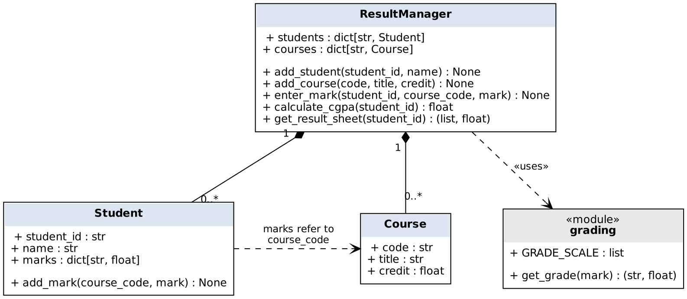

# Student Result Manager

A Python command-line application for recording students' marks and producing their results.

## Features
- Add students (unique ID and name)
- Add courses (code, title, credit)
- Enter marks out of 100 (marks below 0 or above 100 are rejected)
- Letter grade and grade point for each mark
- Credit-weighted CGPA
- Result sheet for each student

## Project Structure
```
student-result-manager/
├── main.py              # menu and user input
├── models.py            # Student and Course classes
├── grading.py           # mark -> grade and grade point
├── result_manager.py    # main logic and CGPA calculation
├── tests/
│   ├── test_grading.py
│   └── test_result_manager.py
└── docs/
    ├── class_diagram.png
    └── class_diagram.dot
```

## How to Run
Requires Python 3.

```bash
python main.py
```

## How to Run Tests
```bash
python -m unittest discover tests -v
```

## Class Diagram


## Team Members
| Name                     | ID          | Contribution |
|--------------------------|-------------|--------------|
|Joyanto Karmakar          | 251414038   | `main.py` (menu and user input), 
                                           `result_manager.py` (main logic and CGPA   calculation), 
                                           `tests/` (unit tests), `README.md`                      | 
|Shantamoni Datta Dola     | 251773038   | `models.py` (Student and Course classes), 
                                           `grading.py` (mark to grade and grade point),
                                            UML class diagram (`docs/`), `.gitignore`              |
